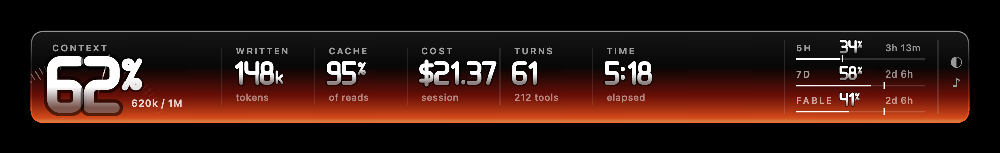
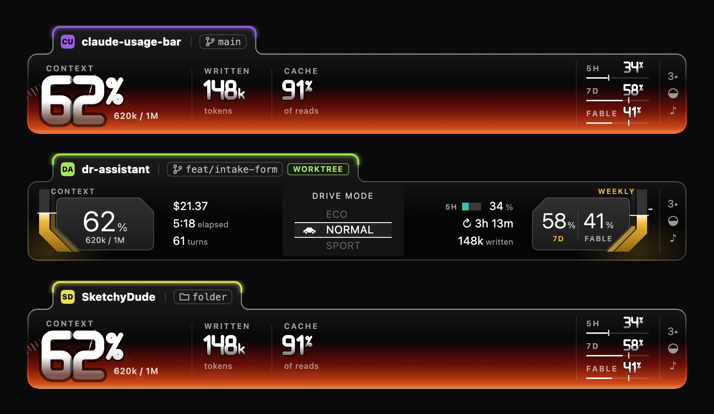
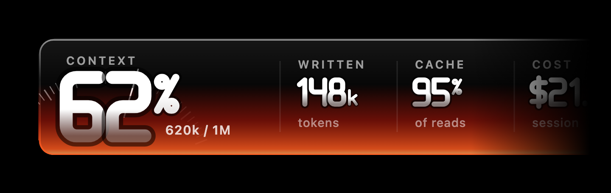
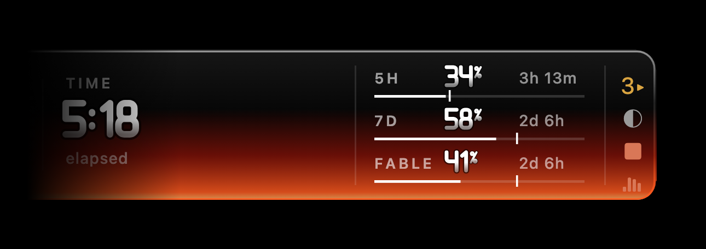
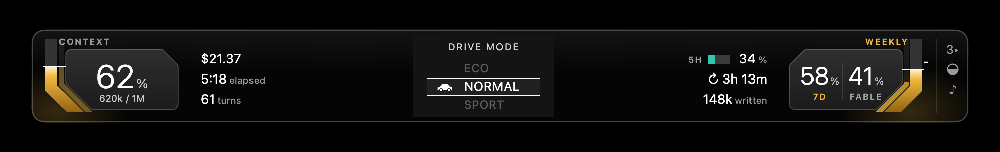
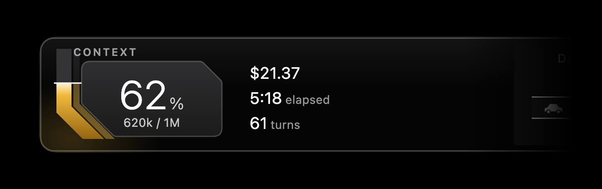
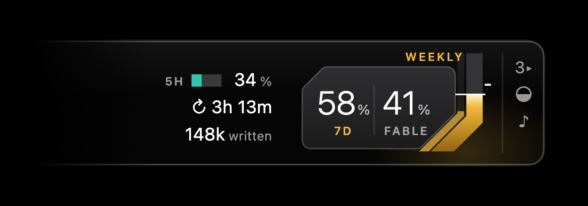
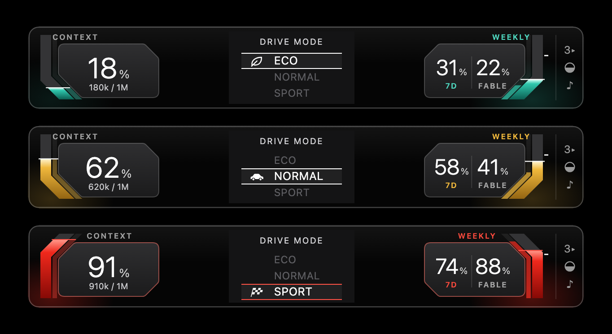
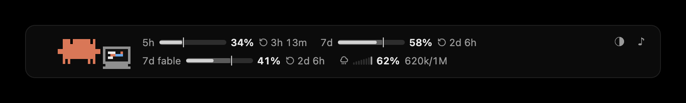
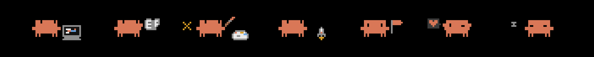

# usage-bar

A mod for Claude Code that draws a band above the prompt with the numbers of the running session.



## What it shows

- **Project:** a tab on the card with the repository, its branch and, in a worktree, a worktree chip, in a colour of the project's own.
- **Context:** how full the context window is, with the tokens in it and the window's size.
- **Session:** tokens written and read, the share of reads served from cache, cost, turns, tool calls and time.
- **Limits:** the 5-hour and weekly windows, and the weekly limit your plan keeps for one model (Fable), each with its pace and reset time.
- **Child sessions:** sessions this one started in the desktop app, with what each is doing and which one is waiting for you.
- **Claude FM:** a button that plays and stops the Claude FM stream.

The band has three modes. The half-disc button steps through them (◐ Glass, ◒ Cluster, ◑ Classic):

- **Glass:** one black card with the context figure, the session's numbers in columns, and the limits on a plate at the right end.
- **Cluster:** the card as a car's instrument cluster, with a gauge at each end and the drive mode between them.
- **Classic:** Clawd beside a row of meters.

In a terminal the band is a few lines of text meters.

### The project tab

With many sessions open across many repositories, the tab says which one this is. It rises from the card's top-left edge in every mode, and stands above Clawd in Classic.



- **Colour:** worked out from the repository's name, so a project has the same colour in every session. Orange and red are left to the card's heat and warnings.
- **Branch:** cut with `…` past 24 characters; `HEAD` and the commit on a detached checkout; `folder` outside a repository.
- **Worktree:** the tab names the main repository and adds a WORKTREE chip.
- **Arrival:** when a session opens or its branch changes, the tab rises out of the card, its strip draws in and a sheen crosses the name. While Claude works, a light runs along the strip. Reduced motion keeps it still.

In a terminal it is the band's first line: the name in bold after a bar in the project's colour, then the branch.

### Glass

Context is the heavy figure over a dial. A heat glow rises from the card's bottom edge as the window fills.



The limits plate, with the rail of buttons at its right end: child sessions, the mode switch, and Claude FM playing.



### Cluster



The left gauge is context, with the tokens in the window under the figure. Cost, time and turns stand beside it.



The right gauge reads two limits side by side: the weekly limit and the one your plan keeps for one model (Fable). Its bar is the weekly limit, the strip beside the bar is the model's, and the white notch outside the bar is the weekly pace: the share of the week gone by. The 5-hour limit, its reset time and the tokens written stand beside it.



The drive mode is how hard the session pushes, and the whole card takes its colour:

- **Eco**, teal: every limit runs 10 points or more under its pace.
- **Normal**, gold.
- **Sport**, red: a limit runs more than 10 points ahead of its pace or is at 90% or more, or context is at 90% or more. The bars bend at the top.



In a narrow pane the numbers beside the list go first, the 5-hour limit with them, then the list; the gauges stay.

### Classic



Clawd follows what the session does: coding, reading, designing, shipping, leading child sessions, proud of a shipped turn, asleep after a long pause.



The pictures are drawn by the mod's own code with example numbers. They are not screenshots of the app.

## Install

At the prompt of a terminal session:

```
/plugin install usage-bar --marketplace behkha/claude-usage-bar
```

Answer `y` to add the marketplace, then pick a scope.

From a shell:

```
claude plugin install usage-bar --marketplace behkha/claude-usage-bar
```

In the desktop app, where `/plugin` does not run: click + next to the prompt box, then Plugins, Add marketplace with `behkha/claude-usage-bar`, then Add plugin.

## What it does on your machine

Read this before installing: the mod does more than draw.

- **Sets a black look** for the app when a session starts.
- **Reads your account's usage report** from `api.anthropic.com` for the per-model limit, with the session's own credential, which stays with the host. It asks once at session start, at most once a minute after a turn, and every 10 minutes while idle. Nothing is sent anywhere else.
- **Reads local session files** under `~/.claude/sessions`, `~/.claude/projects` and the desktop app's own records, to list child sessions. It runs `ps` and `tail` for that.
- **Claude FM** opens the stream in a Google Chrome window through AppleScript and minimizes it; stopping closes that tab. macOS asks for permission the first time you press the button.
- **Reads the repository** the session runs in for the project tab: through Claude Code's own version-control lookup, or on older versions by running `git rev-parse` and `git config --get remote.origin.url` at session start, around each turn and every 30 seconds.
- **Keeps counts** per session in the mod's own store, so a reopened session carries on from where it stood.

Child sessions and Claude FM work on macOS only. Elsewhere those parts stay hidden.

## Develop

Run the mod from its folder while changing it:

```
claude --plugin-dir /path/to/claude-usage-bar
```

Check it with `claude plugin validate .` and, once the engine has laid its types in `.claude-plugin/types/`, `tsc -p .`.

### Adding a mode

A mode that draws the card is four things:

- **Its drawing:** a file in `hooks/` beside `glass.ts` and `cluster.ts`, which turns the session's numbers into SVG. `hooks/card.ts` has the card's size and corners.
- **Its line in `CARDS`** in `hooks/register.tsx`, and its name and button glyph among the scenes there.
- **Its pictures:** one line in `MODES` and its shots in `docs/pictures.ts`. `bun docs/pictures.ts` draws them into `docs/images/` with Google Chrome.
- **Its section** in this file, under "What it shows".

## Credits

The context forecast is adapted from token-weather (anthropics/claude-code-playground, Apache-2.0). Clawd is drawn from Claude Code's own glyph tables.

## License

MIT, see [LICENSE](LICENSE). It covers this mod's own code. `hooks/make-colors.js` and `hooks/make-colors.d.ts` come unchanged from Claude Code's mod-authoring kit, and Clawd is Anthropic's; those stay under their owners' terms.
